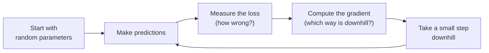
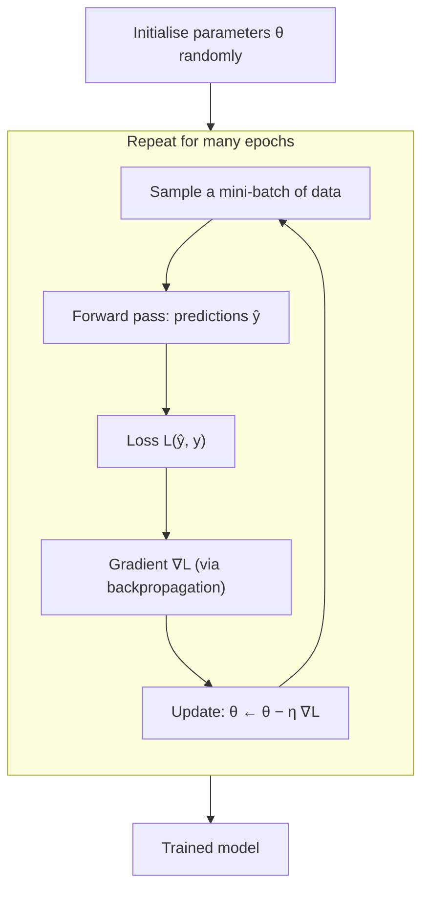

# Gradient Descent

!!! abstract "TL;DR"
    Gradient descent is how almost every AI model learns. You measure **how wrong** the model is (the *loss*), work out **which direction makes it less wrong** (the *gradient*), and take a **small step** that way. Repeat thousands of times, and the model gets good.

**Level:** beginner · **Prerequisites:** basic algebra; knowing that a derivative is "the slope" helps but is not required.

---

## Why should I care?

When people say a neural network "learns", what is really happening is gradient descent (or one of its close relatives, such as Adam). ChatGPT, image classifiers and medical-image segmentation models are all trained this way. Once you understand this lesson, "training a model" stops being magic.

---

## Step 1 — The intuition: walking down a foggy mountain

Imagine you are standing on a mountain in thick fog. You want to reach the lowest point of the valley, but you can only see the ground right under your feet. What do you do?

1. Feel which way the ground slopes.
2. Take a step **downhill**.
3. Repeat until the ground is flat.

That is the whole algorithm. In AI:

| Mountain | Machine learning |
|---|---|
| Your position | The model's **parameters** (its adjustable numbers, also called *weights*) |
| Height of the ground | The **loss**: how wrong the model is |
| Slope under your feet | The **gradient** |
| Size of your step | The **learning rate** |
| Bottom of the valley | The best parameters (lowest loss) |



---

## Step 2 — What are we trying to make small? The loss

Let's use a tiny example. We have 7 data points (blue dots) and want to fit a straight line through the origin:

$$
\hat{y} = w \cdot x
$$

There is only **one** parameter, the slope $w$. For each point the model makes an error $\hat{y}_i - y_i$ (the dashed red lines). We square the errors (so negative and positive errors don't cancel out, and big errors count extra) and take their average. This is the **mean squared error (MSE)** loss:

$$
L(w) = \frac{1}{N}\sum_{i=1}^{N} \left(w\,x_i - y_i\right)^2
$$

**Try it:** drag the slider. Watch the line on the left and the orange dot on the right. The right plot shows the loss for *every* possible value of $w$. It is a bowl, and we want the bottom of it.

<div id="viz-fit" class="viz"><div class="viz-title">🎚️ Interactive: find a good w by hand</div></div>

!!! tip "What to notice"
    - When the line fits the dots well, the dashed error lines are short and the orange dot is near the bottom of the bowl.
    - You found the minimum by *looking* at the whole curve. A real model has millions of parameters, so we can never draw the whole curve. We need a method that only uses local information. That method is gradient descent.

---

## Step 3 — Which way is downhill? The gradient

Look at the **red line** touching the curve in the widget above. That is the **slope** of the loss at your current $w$, written $\frac{dL}{dw}$. It is the "feel the ground under your feet" step.

- Slope **positive** → loss goes *up* as $w$ increases → move $w$ **left** (decrease it).
- Slope **negative** → loss goes *down* as $w$ increases → move $w$ **right** (increase it).
- Slope **≈ 0** → the ground is flat → you're at the bottom.

So the rule is simple: **always move opposite to the slope.**

For our loss, calculus gives the slope directly:

$$
\frac{dL}{dw} = \frac{1}{N}\sum_{i=1}^{N} 2\,x_i\left(w\,x_i - y_i\right)
$$

You don't need to derive this yourself. In practice libraries like PyTorch compute it automatically (this is called *automatic differentiation*, and *backpropagation* in neural networks). What matters is the meaning: **it tells us which way is uphill, and how steep it is.**

!!! note "Gradient vs. derivative"
    With one parameter we call it the *derivative* or *slope*. With many parameters we get one slope per parameter. That list of slopes is called the **gradient**, written $\nabla L$. It points in the direction of steepest *ascent*, so we walk the opposite way.

---

## Step 4 — Taking the step: the update rule

Now combine everything into one line, the heart of gradient descent:

$$
w_{\text{new}} = w_{\text{old}} - \eta \cdot \frac{dL}{dw}
$$

- The **minus sign** means "go opposite to the slope", i.e. downhill.
- $\eta$ (Greek letter *eta*) is the **learning rate**: how big a step to take.
- Steep slope → big step; gentle slope → small step. The algorithm slows down by itself as it nears the bottom.

**Try it:** press **Run 30 steps**, then try the preset learning rates. The green ring marks the true minimum.

<div id="viz-gd1d" class="viz"><div class="viz-title">🏃 Interactive: gradient descent in action</div></div>

!!! tip "What to notice: the learning rate matters a lot"
    | Learning rate | What happens |
    |---|---|
    | **Too small** (0.01) | Safe but slow: after 30 steps it still hasn't arrived. |
    | **Good** (0.05) | Gets to the bottom quickly and smoothly. |
    | **Big** (0.18) | Overshoots and bounces from side to side, but slowly settles. |
    | **Too big** (0.22) | Every jump lands *higher* than the last one, and the loss explodes. This is called **divergence**. |

    Choosing the learning rate is one of the most important practical decisions when training a model.

---

## Step 5 — More parameters: a landscape instead of a curve

Real models have more than one parameter. Let's add an intercept $b$, so the line no longer has to pass through the origin:

$$
\hat{y} = w \cdot x + b
$$

Now the loss depends on **two** numbers, $L(w, b)$. Instead of a curve, it is a **surface**, like a real valley. Below, we view it from above as a *contour map*: the stronger the purple, the lower the loss. The green ring marks the minimum. The gradient now has two parts, one per parameter:

$$
\nabla L = \left(\frac{\partial L}{\partial w},\; \frac{\partial L}{\partial b}\right),
\qquad
\begin{aligned}
w &\leftarrow w - \eta\,\frac{\partial L}{\partial w}\\
b &\leftarrow b - \eta\,\frac{\partial L}{\partial b}
\end{aligned}
$$

Exactly the same rule, applied to each parameter at the same time.

<div id="viz-gd2d" class="viz"><div class="viz-title">🗺️ Interactive: descending a 2-D loss landscape</div></div>

!!! tip "What to notice"
    - **Click** different starting points. Every path ends at the green ring, because this bowl has only one bottom.
    - The valley is long and narrow. With a learning rate around 0.15 the path **zig-zags** across the narrow direction while crawling along the long one. This exact problem is what improved optimizers like **Momentum** and **Adam** were invented to fix (a future lesson).
    - Push the learning rate to 0.2 and the path diverges, just as in 1-D.

---

## Step 6 — Real data is big: Stochastic Gradient Descent (SGD)

To compute the exact gradient we averaged over **all** data points. With 7 points that's easy. With 10 million images it is far too slow to do for every single step.

The trick is to **estimate** the gradient from a small random subset of the data, called a **mini-batch**, at every step:

| Variant | Gradient computed from | Each step is… |
|---|---|---|
| **Batch** gradient descent | all $N$ examples | accurate but slow |
| **Stochastic** gradient descent (SGD) | 1 random example | very cheap but noisy |
| **Mini-batch** gradient descent | e.g. 32–512 examples | the practical sweet spot, used almost everywhere |

**Try it:** in the 2-D widget above, switch *gradient from* to **1 random point (SGD)** and press Run. The path becomes wobbly, because each step only "sees" one point. It still heads towards the minimum on average. That noise is not all bad: in deep learning it can even help the model escape poor regions.

!!! info "Vocabulary: epoch"
    One **epoch** is one full pass over the training data. With 10,000 examples and a mini-batch of 100, one epoch is 100 steps.

---

## Putting it all together



Here is the full algorithm from the 2-D widget, in a few lines of NumPy:

```python
import numpy as np

x = np.array([0.5, 1.0, 1.5, 2.0, 2.5, 3.0, 3.5])
y = np.array([1.3, 1.6, 3.2, 4.5, 4.7, 6.1, 6.8])

w, b = -0.5, 5.0        # starting point
lr = 0.1                # learning rate (η)

for step in range(200):
    y_hat = w * x + b                     # 1. predict
    error = y_hat - y
    loss = np.mean(error ** 2)            # 2. measure loss (MSE)
    grad_w = np.mean(2 * error * x)       # 3. gradient
    grad_b = np.mean(2 * error)
    w -= lr * grad_w                      # 4. step downhill
    b -= lr * grad_b

print(f"w = {w:.3f}, b = {b:.3f}, loss = {loss:.4f}")
```

And the same thing in PyTorch, which computes the gradient for you:

```python
import torch

x = torch.tensor([0.5, 1.0, 1.5, 2.0, 2.5, 3.0, 3.5])
y = torch.tensor([1.3, 1.6, 3.2, 4.5, 4.7, 6.1, 6.8])
w = torch.tensor(-0.5, requires_grad=True)
b = torch.tensor(5.0, requires_grad=True)
optimizer = torch.optim.SGD([w, b], lr=0.1)

for step in range(200):
    loss = ((w * x + b - y) ** 2).mean()
    optimizer.zero_grad()   # clear old gradients
    loss.backward()         # compute gradients automatically
    optimizer.step()        # w ← w − lr · grad
```

---

## Common misconceptions

!!! warning "\"Gradient descent always finds the best possible answer.\""
    Only for bowl-shaped (*convex*) losses like the ones in this lesson. Neural-network loss landscapes have many hills, valleys and flat regions. Gradient descent finds *a* low point, not necessarily *the* lowest. In practice, these low points are usually good enough.

!!! warning "\"A bigger learning rate means faster training.\""
    Only up to a point. Past it, training oscillates or diverges (you saw this in Step 4). That's why practitioners often use *learning-rate schedules* that start larger and shrink over time.

!!! warning "\"The gradient points towards the minimum.\""
    It points in the direction of steepest *local* descent, which is not necessarily straight at the minimum. The zig-zag in the 2-D widget shows this clearly.

---

## Check yourself

??? question "1. At the current w, the slope dL/dw = +3. Should w increase or decrease?"
    **Decrease.** A positive slope means the loss rises as $w$ grows, so we move the opposite way: $w_{\text{new}} = w - \eta \cdot 3$.

??? question "2. Your training loss gets bigger every step and eventually becomes `NaN`. What is the most likely cause?"
    The **learning rate is too large**, so gradient descent is diverging. Try reducing it by a factor of 10.

??? question "3. Why does gradient descent automatically take smaller steps near the minimum, even with a fixed learning rate?"
    Because the step is $\eta \times$ gradient, and the gradient (the slope) gets close to zero near the bottom of the bowl.

??? question "4. What is the difference between batch GD and SGD?"
    Batch GD computes the gradient from **all** training examples: it is accurate but slow per step. SGD uses **one** (or a small mini-batch of) random examples: each step is cheap and noisy, but on average it still points downhill.

??? question "5. With 50,000 training images and a mini-batch size of 250, how many update steps are in one epoch?"
    $50{,}000 / 250 = $ **200 steps**.

---

## Further reading

- 3Blue1Brown, [*Gradient descent, how neural networks learn*](https://www.youtube.com/watch?v=IHZwWFHWa-w) (video)
- Sebastian Ruder, [*An overview of gradient descent optimization algorithms*](https://arxiv.org/abs/1609.04747) (2016), the classic survey of SGD, Momentum, Adam and others
- Goodfellow, Bengio & Courville, [*Deep Learning*](https://www.deeplearningbook.org/), Chapter 4.3 (Gradient-Based Optimization)
- Distill, [*Why Momentum Really Works*](https://distill.pub/2017/momentum/), a beautiful interactive follow-up to the zig-zag problem

**Next lessons:** Backpropagation · Optimizers (Momentum, Adam)

<script src="viz/gradient-descent.js"></script>
