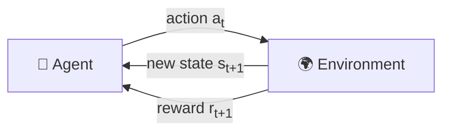
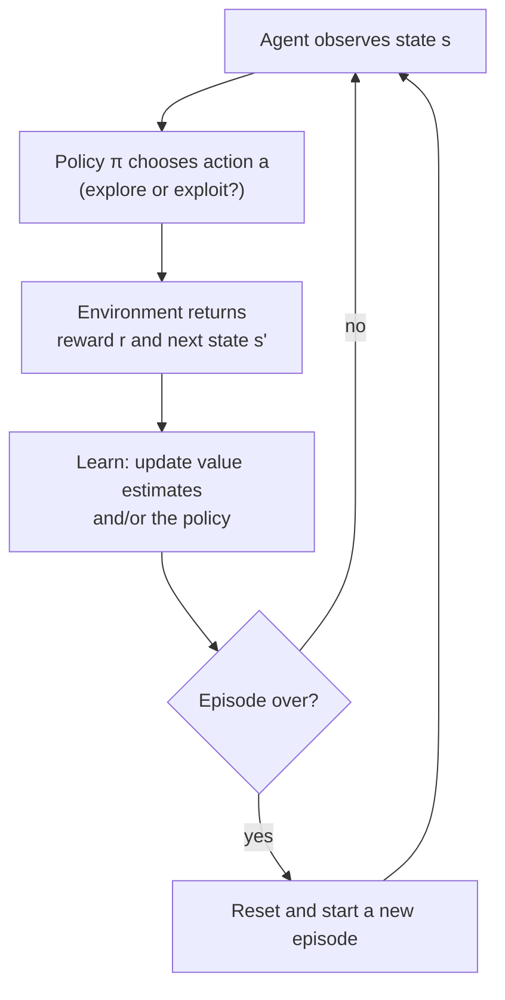
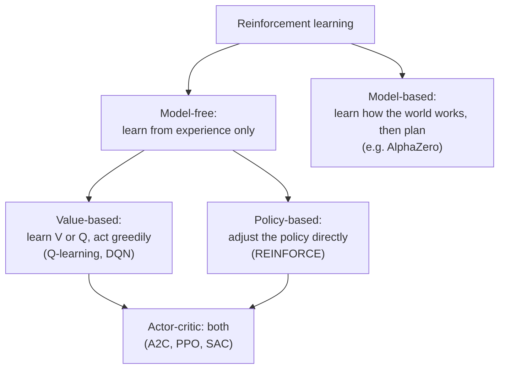

# What is Reinforcement Learning?

!!! abstract "TL;DR"
    In reinforcement learning (RL), an **agent** learns by **trial and error**. It looks at the **state** of its world, takes an **action**, and gets back a **reward**: a number saying how good that was. Nobody tells it the right answer. Its goal is to find a **policy** (a strategy) that collects as much reward as possible **over the long run**, not just right now.

**Level:** beginner · **Prerequisites:** none. Knowing what a sum ($\sum$) is helps for the math.

---

## Why should I care?

Some of the most striking results in AI came from reinforcement learning:

- **Games:** AlphaGo beat the world champion at Go (2016), and Atari-playing agents learned dozens of games from raw pixels.
- **Robotics and control:** robot hands that learn to manipulate objects, and controllers that cool data centres or shape the plasma in fusion reactors.
- **Chatbots:** ChatGPT, Claude and other assistants are fine-tuned with *RL from human feedback* (RLHF). The "reward" is a score for how helpful and safe a reply is.

The common thread: there is **no dataset of correct answers**, only a way to tell whether things went well. RL is the toolbox for learning in that situation.

---

## Step 1 — Learning from consequences, not from answers

Think about how you teach a dog to sit. You can't show it a thousand labelled examples of "correct sitting". Instead, it tries things, and when it happens to sit, it gets a treat. Over time it learns that sitting (when you say "sit") leads to treats.

That is reinforcement learning. Compare it with the other two main kinds of machine learning:

| | Supervised learning | Unsupervised learning | **Reinforcement learning** |
|---|---|---|---|
| What you get | inputs **with correct labels** | inputs only | a **reward** after each action |
| The question it answers | "What is the right output?" | "What structure is in this data?" | "What should I **do**?" |
| Feedback is… | immediate and exact | none | delayed, noisy, just a score |
| Example | classify an X-ray | group customers | play a game, steer a robot |

Two things make RL harder than supervised learning:

1. **The reward doesn't say what the right action was.** A score of −1 tells you that you did badly, not what you should have done instead.
2. **Rewards can be delayed.** In chess the only real reward is winning or losing at the very end. Which of your 40 moves deserves the credit? This is called the **credit assignment problem**.

---

## Step 2 — The loop: agent and environment

Every RL problem has the same two players:

- The **agent**: the learner and decision-maker (the dog, the game player, the robot's controller).
- The **environment**: everything outside the agent (the room, the game, the physical world).

They interact in a loop, one **time step** at a time:



1. The agent sees the current **state** $s_t$ (where am I? what does the board look like?).
2. It picks an **action** $a_t$ (move left, push the button, say this word).
3. The environment responds with a **new state** $s_{t+1}$ and a **reward** $r_{t+1}$.
4. Repeat.

One run from a starting state to an ending (**terminal**) state is called an **episode**, for example one game of chess or one attempt to cross a room.

**Try it:** you are the agent. Get the orange dot to the goal. Each step costs −1 (so dawdling is bad), reaching the goal gives +10, and stepping into the cliff gives −20 and ends the episode. Then turn on the **slippery floor** and play a few more episodes.

<div id="viz-play" class="viz"><div class="viz-title">🎮 Interactive: be the agent</div></div>

!!! tip "What to notice"
    - The shortest route (up one, right along the cliff edge, down) needs 7 steps, for a total reward of $6 \times (-1) + 10 = +4$. The route along the top row needs 11 steps, for a total of 0.
    - With the slippery floor on, the **same action** in the **same state** can lead to different results. Environments are often random like this, and a good agent has to plan for it. Does walking along the cliff edge still feel like a good idea?
    - You could see the whole map. A real RL agent starts with **no idea** where the goal or the cliff is. It has to discover them by trying, falling off the cliff many times along the way.

!!! note "State, action, reward in the wild"
    | Problem | State | Actions | Reward |
    |---|---|---|---|
    | This grid world | which cell you are in | up, right, down, left | −1 per step, +10 goal, −20 cliff |
    | Atari game | the screen pixels | joystick moves | change in game score |
    | Robot arm | joint angles, camera image | motor torques | +1 when the object is grasped |
    | Chatbot (RLHF) | the conversation so far | the next word | a score for the finished reply |

---

## Step 3 — What does "best" mean? The return and discounting

The agent's goal is **not** to get the biggest reward on the next step. It is to get the most reward **in total**, from now until the end. This total is called the **return**, written $G_t$:

$$
G_t = r_{t+1} + r_{t+2} + r_{t+3} + \dots
$$

In practice we almost always add a **discount factor** $\gamma$ (Greek *gamma*, a number between 0 and 1), which makes rewards in the future count for less:

$$
G_t = r_{t+1} + \gamma\, r_{t+2} + \gamma^2\, r_{t+3} + \dots = \sum_{k=0}^{\infty} \gamma^k\, r_{t+k+1}
$$

A reward that arrives $k$ steps from now is multiplied by $\gamma^k$. With $\gamma = 0.9$, a reward 10 steps away is worth only $0.9^{10} \approx 0.35$ of its face value.

Why discount at all?

- **A bird in the hand.** The future is uncertain, so sooner is safer.
- **It keeps the maths finite.** If an episode could go on forever, an undiscounted sum could be infinite.
- **It is a dial for patience.** $\gamma$ near 0 → a short-sighted agent that only cares about the next reward. $\gamma$ near 1 → a far-sighted agent that will accept pain now for a bigger payoff later.

**Try it:** which would the agent rather have: **+4 right now**, or **+10 six steps later**? Drag $\gamma$ and watch the answer flip.

<div id="viz-discount" class="viz"><div class="viz-title">⏳ Interactive: what is a future reward worth today?</div></div>

!!! tip "What to notice"
    - At $\gamma = 0$ only the very first reward counts, so the agent always grabs A.
    - Around $\gamma \approx 0.86$ the two options are worth the same ($10 \cdot \gamma^6 = 4$).
    - At $\gamma = 0.99$ the agent is patient: B is worth almost its full 10.
    - Choosing $\gamma$ changes what "best behaviour" means. Typical values in practice are 0.9 to 0.999.

---

## Step 4 — The agent's strategy: the policy

How does the agent decide what to do? It follows a **policy**, written $\pi$ (Greek *pi*). A policy is simply a rule that says which action to take in each state.

- A **deterministic** policy picks one action per state: $a = \pi(s)$. In our grid world, that is one arrow per cell.
- A **stochastic** policy gives a probability for each action: $\pi(a \mid s)$, "the chance of taking action $a$ in state $s$". The random policy below (✱) is the extreme case: every direction has probability $\tfrac{1}{4}$.

**Learning, in RL, means improving the policy.** The goal is to find an **optimal policy** $\pi^*$: one that gets the highest expected return from every state.

In simple problems a policy can be a lookup table (one arrow per cell). In hard problems like Atari or robotics it is a **neural network**: it takes the state as input and outputs action probabilities. That is where deep learning and RL meet (*deep reinforcement learning*).

---

## Step 5 — How good is a state? The value function

To improve a policy we need to measure how good it is. The **value** of a state, under a policy $\pi$, is the return you can **expect** if you start there and follow $\pi$ from then on:

$$
V^{\pi}(s) = \mathbb{E}_{\pi}\left[\, G_t \mid s_t = s \,\right]
$$

"Expected" means *averaged over all the random things that can happen*: the random choices of a stochastic policy, and the random slips of the environment. You can estimate it by playing many episodes from $s$ and averaging their returns.

**Try it:** the board below shows a policy (the arrows) and, in each cell, the value $V^\pi(s)$ for that policy. Green cells are good places to be, red cells are bad. Click cells to change arrows, or pick a preset.

<div id="viz-policy" class="viz"><div class="viz-title">🧭 Interactive: a policy and its value</div></div>

!!! tip "What to notice"
    1. **Values summarise the future.** Cells close to the goal are greener, because you can expect a good return from there. With the **Random** policy almost every cell is deep red: wandering at random usually ends in the cliff (from the start cell, $V \approx -19.9$).
    2. **Values are an average over real experience.** Press **Run 1000 episodes**. The average return of 1000 played episodes lands very close to $V(\text{start})$. That is literally what the value means.
    3. **The best policy depends on the environment.** With slip chance 0, *Edge of the cliff* is better than *Safe detour* ($V = 2.05$ vs $-2.04$). Raise the slip chance to 0.2 and the order flips ($-9.08$ vs $-6.97$): on a slippery floor the risky shortcut falls off the cliff too often.
    4. **It also depends on $\gamma$.** With slip 0, lower $\gamma$ to 0.5: the two policies become almost equally good ($-1.81$ vs $-1.99$), because a short-sighted agent barely cares about the +10 at the end.
    5. **One bad arrow ripples backwards.** Choose *Safe detour* and click the top-right cell once, so it points left. The agent now bounces between two cells forever, and every cell that leads there turns red.

!!! note "Two kinds of value"
    $V^\pi(s)$ answers "how good is it to be **in** state $s$?" A close relative, the **action-value** $Q^\pi(s, a)$, answers "how good is it to take action $a$ in state $s$, then follow $\pi$?" If you know $Q$, choosing well is easy: in each state, pick the action with the highest $Q$. That idea is the heart of **Q-learning** (a later lesson).

---

## Step 6 — Explore or exploit?

There is one more challenge that supervised learning never faces. Because the agent learns from its own actions, it must decide between:

- **Exploiting:** do what has worked best so far, to collect reward now.
- **Exploring:** try something new, which might be worse, but might reveal something better.

Think of choosing a restaurant. Going to your favourite is exploiting. Trying the new place down the street is exploring. Exploit always and you may never find something better; explore always and you eat a lot of bad meals.

An RL agent that only exploits could take the safe route on its first lucky episode and never discover the shorter one. The simplest fix is **ε-greedy** (epsilon-greedy): most of the time take the best-known action, but with a small probability $\varepsilon$ (say 10%), take a random one. The *Multi-armed bandits* lesson explores this trade-off in depth.

---

## Putting it all together



All the RL methods on the [roadmap](../../roadmap.md#reinforcement-learning) are different answers to one question: **how exactly do we do the "Learn" box?**



Here is the grid world from this lesson in plain Python. It uses the same `reset()` / `step()` interface as most RL libraries:

```python
import random

MAP = ["......",
       "..#...",
       "......",
       "SCCCCG"]
MOVES = {"up": (-1, 0), "right": (0, 1), "down": (1, 0), "left": (0, -1)}


class CliffWorld:
    """−1 per step, +10 at the goal, −20 for falling off the cliff."""

    def __init__(self, slip=0.0):
        self.slip = slip            # chance of sliding sideways instead of moving as intended

    def reset(self):
        self.pos = (3, 0)
        return self.pos             # the first state

    def step(self, action):
        if random.random() < self.slip:                     # slippery floor: slide left or right
            sideways = {"up": ["left", "right"], "down": ["left", "right"],
                        "left": ["up", "down"], "right": ["up", "down"]}
            action = random.choice(sideways[action])
        dr, dc = MOVES[action]
        r, c = self.pos[0] + dr, self.pos[1] + dc
        if 0 <= r < 4 and 0 <= c < 6 and MAP[r][c] != "#":  # walls and edges: stay put
            self.pos = (r, c)
        tile = MAP[self.pos[0]][self.pos[1]]
        if tile == "G":
            return self.pos, +10, True                      # next state, reward, episode over?
        if tile == "C":
            return self.pos, -20, True
        return self.pos, -1, False


def run_episode(env, policy, gamma=0.95, max_steps=100):
    state = env.reset()
    G, discount = 0.0, 1.0
    for t in range(max_steps):
        action = policy(state)                     # 1. agent picks an action
        state, reward, done = env.step(action)     # 2. environment responds
        G += discount * reward                     # 3. add up the discounted reward
        discount *= gamma
        if done:
            break
    return G


def random_policy(state):
    return random.choice(list(MOVES))


def edge_policy(state):                            # hug the cliff: up once, then right, then down
    r, c = state
    if r == 3:
        return "up"
    if r < 2:
        return "down" if c != 2 else "right"     # (0, 2) sits above the wall
    return "down" if c == 5 else "right"


for slip in [0.0, 0.2]:
    env = CliffWorld(slip)
    for name, policy in [("random", random_policy), ("edge", edge_policy)]:
        returns = [run_episode(env, policy) for _ in range(10_000)]
        print(f"slip={slip}  {name:6s}  average return = {sum(returns) / len(returns):6.2f}")
```

```text
slip=0.0  random  average return = -19.87
slip=0.0  edge    average return =   2.05
slip=0.2  random  average return = -19.87
slip=0.2  edge    average return =  -9.10
```

These averages match the values $V(\text{start})$ shown in the policy widget. Notice that **nothing here learns yet**: the policies are written by hand. Making the agent find a good policy by itself is what the next lessons are about.

For real projects, the standard library of environments is [Gymnasium](https://gymnasium.farama.org/) (`pip install gymnasium`). The loop looks exactly the same:

```python
import gymnasium as gym

env = gym.make("FrozenLake-v1", is_slippery=True)   # a slippery grid world, much like ours
state, info = env.reset(seed=0)
total = 0.0
done = False
while not done:
    action = env.action_space.sample()               # a random policy
    state, reward, terminated, truncated, info = env.step(action)
    total += reward
    done = terminated or truncated
print("return:", total)
```

---

## Common misconceptions

!!! warning "\"The agent tries to maximise the next reward.\""
    It tries to maximise the **return**: the (discounted) sum of all future rewards. Often the best action has a bad immediate reward, like sacrificing a piece in chess or taking the long way round the cliff.

!!! warning "\"The reward tells the agent what it should have done.\""
    A reward is just a score for what *did* happen. It never says what the right action was. That is the key difference from supervised learning, and the reason RL needs so much trial and error.

!!! warning "\"Reward and value are the same thing.\""
    The **reward** is the immediate signal from the environment, one step at a time. The **value** is the agent's prediction of the *total future* reward from a state. A cell next to the cliff gives the same −1 reward as any other cell, but under a risky policy its value is much lower.

!!! warning "\"If I give rewards for the right things, the agent will do what I want.\""
    Agents are very good at finding loopholes. A famous example is a boat-racing agent that learned to spin in circles collecting bonus points instead of finishing the race. Designing rewards that really capture what you want (*reward design*) is one of the hardest parts of applied RL.

---

## Check yourself

??? question "1. Name the agent, a state, an action and the reward for a self-driving car learning to park."
    **Agent:** the car's controller. **State:** camera and sensor readings, the car's position and speed. **Actions:** steering angle, accelerate, brake. **Reward:** for example +100 for parking correctly, −100 for a collision, and a small −1 per second to encourage speed.

??? question "2. An agent receives rewards 0, 0, 0, +8 on its next four steps, then the episode ends. What is its return with γ = 0.5?"
    $G = 0 + 0.5 \cdot 0 + 0.5^2 \cdot 0 + 0.5^3 \cdot 8 = 0.125 \cdot 8 = $ **1**.

??? question "3. What happens to an agent's behaviour if you set γ = 0?"
    It becomes completely **short-sighted** (myopic): only the very next reward matters, so it ignores any long-term consequence of its actions.

??? question "4. In the policy widget, why does the cliff-edge policy get worse as the slip chance grows, while it is the best with no slip?"
    With no slip, the edge path is the shortest, so it pays the fewest −1 step costs. With slip, every step along the edge risks sliding into the cliff (−20). Averaged over many episodes, those falls cost more than the extra steps of the safe detour. The **value** captures this average, which is why the best policy depends on the environment's randomness.

??? question "5. What is the difference between exploration and exploitation, and why does an RL agent need both?"
    **Exploitation** means choosing the action currently believed to be best; **exploration** means trying other actions to learn more. Without exploration the agent may never discover a better strategy; without exploitation it never cashes in on what it has learned.

---

## Further reading

- Richard Sutton & Andrew Barto, [*Reinforcement Learning: An Introduction*](http://incompleteideas.net/book/the-book-2nd.html) (2nd ed., free online), Chapters 1 and 3. *The* RL textbook.
- David Silver, [*UCL Course on RL*](https://www.davidsilver.uk/teaching/), Lecture 1: Introduction to Reinforcement Learning (video + slides)
- OpenAI, [*Spinning Up in Deep RL: Key Concepts*](https://spinningup.openai.com/en/latest/spinningup/rl_intro.html), a compact, practical summary of the vocabulary
- Andrej Karpathy, [*Deep Reinforcement Learning: Pong from Pixels*](https://karpathy.github.io/2016/05/31/rl/), a fun walk-through of learning a game end to end
- OpenAI, [*Faulty Reward Functions in the Wild*](https://openai.com/index/faulty-reward-functions/), the boat-racing example

**Next lessons:** Multi-armed bandits · Markov decision processes (MDPs) and Bellman equations

<script src="viz/reinforcement-learning-intro.js"></script>
